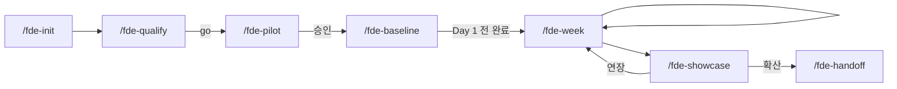

# FDE Harness: Claude Code & Codex Dual Plugin

고객사에 Claude를 납품하는 FDE(Forward Deployed Engineer)의 30일 활성화 engagement를 단계 게이트로 진행하는 플러그인입니다. Claude Code와 OpenAI Codex에서 같은 절차로 동작하고, 다른 플러그인 없이 단독으로 동작합니다.

> v1.0.0은 v0.6.0(spec 기반 코딩 루프)을 전면 교체한 버전입니다. 이전 버전은 `v0.6.0` 태그에 있습니다.

## 무엇을 하는가

- 과제 후보를 네 기준으로 점수 매기고, 일의 단위가 바뀌는 과제(structural gain)를 고릅니다
- 파일럿의 성공 기준을 측정 가능한 지표로만 정합니다
- Day 1 전에 기준선을 잡지 않으면 주간 기록을 시작하지 않습니다
- 주마다 사용 현황, 위임 수준, 지표, 실패 유형을 기록합니다
- Day 30에 기준선 대비 ROI 스코어카드와 가설 판정을 만들고, 확산, 연장, 중단을 결정합니다
- 챔피언에게 `CLAUDE.md`, 스킬, 주간 리듬을 4페이즈로 인계합니다
- 실패 유형을 고객을 넘어 누적해 다음 engagement의 주간 점검에 씁니다

단계, 게이트, 판정 규칙의 기준 문서는 **[docs/methodology.md](docs/methodology.md)** 입니다.

## 흐름



## 포함된 컴포넌트

- **Skill 1개**: `skills/fde-engagement/`: 현재 단계를 판정하고 해당 절차로 보냅니다. Codex에서는 이 스킬이 커맨드 파일의 절차를 따릅니다
- **Slash Command 7개**:
  - `/fde-init {고객}`: engagement 폴더와 브리프 생성
  - `/fde-qualify`: 과제 선별과 go 승인
  - `/fde-pilot`: 코호트, 범위, 기간, 성공 기준, 고객 저장소 Claude Code 설정 점검
  - `/fde-baseline`: Day 1 전 기준선 기록
  - `/fde-week [n]`: 주간 기록과 실패 유형 대조
  - `/fde-showcase`: ROI 스코어카드, 가설 판정, 다음 결정
  - `/fde-handoff`: 챔피언 인계와 완료 신호 점검
- **Template 8개** (`templates/`): brief, qualify, pilot, baseline, week, showcase, handoff, failure-modes

## 사용자 프로젝트에 생기는 구조

```
engagements/
├── failure-modes.md        고객 공통, 추가만 함
└── {고객}/
    ├── brief.md
    ├── 01-qualify.md
    ├── 02-pilot.md
    ├── 03-baseline.md
    ├── weeks/W1.md ...
    ├── 04-showcase.md
    └── 05-handoff.md
```

각 단계 파일의 frontmatter `status`가 `approved`여야 다음 단계로 넘어갑니다. `approved`는 사용자가 명시적으로 승인했을 때만 기록됩니다.

## 설치 방법

### Claude Code

```bash
# 방법 1: 마켓플레이스를 통한 설치 (이 리포지토리가 GitHub에 있을 경우)
/plugin marketplace add SeokRae/fde-harness
/plugin install fde-harness

# 방법 2: 로컬 설치
git clone https://github.com/SeokRae/fde-harness ~/.claude/plugins/fde-harness
# Claude Code 재시작
```

### Codex

```bash
# 로컬 마켓플레이스에 등록
mkdir -p ~/.agents/plugins
cp -r ./fde-harness ~/.agents/plugins/
# ~/.agents/plugins/marketplace.json 에 항목 추가
codex plugin marketplace add ~/.agents/plugins
```

또는 `~/.codex/config.toml` 에 직접 추가:

```toml
[[plugins]]
name = "fde-harness"
path = "/path/to/fde-harness"
enabled = true
```

## 다음으로 추가할 만한 것

| 증상 | 추가할 것 |
|------|----------|
| 30일 이후 조직 확산을 추적해야 함 | CoE 구성, Train the Trainer 단계 커맨드 |
| 여러 고객의 ROI를 비교해야 함 | engagement 횡단 요약 커맨드 |
| 실패 유형이 많아져 주간 점검이 길어짐 | 업종이나 과제 유형별 실패 유형 필터 |

## 출처

단계 구조와 기준 항목은 Anthropic Academy 파트너 학습 경로 [Claude Forward Deployed Engineer](https://anthropic-partners.skilljar.com/path/claude-fde)의 강의 소개를 참고했습니다. 강의 문구는 옮기지 않았습니다. 자세한 범위는 [docs/methodology.md §0](docs/methodology.md)에 있습니다.

## 라이선스

MIT. 자유롭게 fork해서 팀에 맞게 고쳐 쓰세요.
