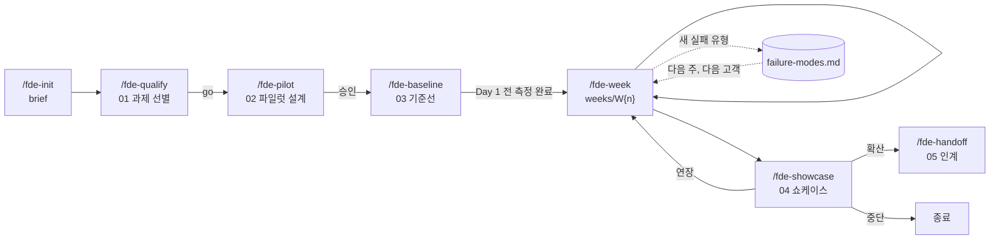

# FDE 납품 방법론: 단계와 게이트

이 문서는 fde-harness의 단계, 게이트, 산출물의 단일 기준(SSoT)입니다. README, 스킬, 커맨드, 템플릿은 이 문서를 링크만 합니다. 내용을 복사하지 않습니다.

## 0. 출처와 범위

- 단계 구조와 기준 항목은 Anthropic Academy 파트너 학습 경로 [Claude Forward Deployed Engineer](https://anthropic-partners.skilljar.com/path/claude-fde)의 두 강의 소개 페이지를 참고했습니다. 강의는 "Delivery Methodology"와 "Driving enterprise adoption of Claude"입니다.
- 참고한 것은 공개된 강의 소개와 커리큘럼 목차입니다. 강의 본문은 반영하지 않았습니다.
- 강의 문구는 옮기지 않았습니다. 이 문서의 설명과 판정 규칙은 이 저장소가 정한 것입니다.
- 이 하네스는 다른 플러그인에 의존하지 않습니다. Claude Code, Codex, Claude 앱(claude.ai 웹, 데스크톱)에서 같은 스킬 폴더로 동작합니다.

## 1. 한 장 요약

## 2. 두 가지 이득

과제를 고를 때 가장 먼저 이득의 종류를 판정합니다.

| 종류 | 뜻 | 30일 안 증명 |
|---|---|---|
| marginal | 같은 일을 같은 방식으로 더 빨리 합니다 | 어렵습니다. 체감은 크지만 경영진 보고의 근거로 약합니다 |
| structural | 일의 단위가 바뀝니다. 필요한 인원, 기간, 단계 수가 줄어듭니다 | 가능합니다. 바뀐 단위를 기준선과 나란히 보여 줍니다 |

marginal만 있는 과제는 파일럿 대상으로 올리지 않습니다. 사용자가 그래도 진행한다고 결정하면, 그 결정을 `01-qualify.md`에 기록합니다.

## 3. 단계와 게이트

각 단계의 "커맨드"는 Claude Code의 슬래시 커맨드입니다. 슬래시 커맨드가 없는 환경에서는 "과제 선별 진행해줘"처럼 단계 이름으로 요청하면, 스킬이 같은 절차(`references/procedures/{단계}.md`)를 따릅니다.

모든 단계 파일은 frontmatter에 `status`를 둡니다. 값은 `draft` 또는 `approved`입니다. 다음 단계 커맨드는 앞 단계의 `status: approved`를 확인합니다. 확인하지 못하면 다음 단계 파일을 만들지 않고 이유를 알립니다.

`approved`는 사용자가 채팅에서 명시적으로 승인했을 때만 씁니다. AI가 스스로 승인하지 않습니다.

### 3.1 init: 고객 브리프

| 항목 | 내용 |
|---|---|
| 커맨드 | `/fde-init {고객-slug}` |
| 산출물 | `engagements/{고객}/brief.md`, `engagements/failure-modes.md`(없을 때만) |
| 담는 것 | 고객 상황, 이해관계자, 경영진 스폰서, 챔피언 후보, Day 1과 Day 30 예정일 |
| 게이트 | 없음 |

### 3.2 qualify: 과제 선별

| 항목 | 내용 |
|---|---|
| 커맨드 | `/fde-qualify` |
| 산출물 | `engagements/{고객}/01-qualify.md` |
| 선행 조건 | `brief.md` 존재 |
| 게이트 | 아래 판정을 채우고 사용자가 go를 승인 |

과제 후보마다 네 기준을 1~5점으로 매깁니다.

| 기준 | 질문 |
|---|---|
| 물량 (volume) | 이 일이 30일 안에 측정할 만큼 자주 일어나는가 |
| 복잡도 (complexity) | 사람 손이 많이 가는 판단과 조합이 있는가 |
| 측정 가능성 (measurability) | 시작 전에 숫자로 잡을 수 있는 지표가 있는가 |
| 개발자 준비도 (developer readiness) | 코호트가 도구를 쓸 시간과 의지가 있는가 |

판정 규칙:

- 측정 가능성이 2점 이하이면 탈락합니다. 기준선을 잡을 수 없기 때문입니다.
- 네 기준 중 하나라도 1점이면 탈락합니다.
- 이득 종류가 marginal만이면 보류합니다(§2).
- 남은 후보 중 파일럿 과제를 1~2개 고릅니다. 고른 이유를 한 줄로 적습니다.

### 3.3 pilot: 파일럿 설계

| 항목 | 내용 |
|---|---|
| 커맨드 | `/fde-pilot` |
| 산출물 | `engagements/{고객}/02-pilot.md` |
| 선행 조건 | `01-qualify.md`가 `approved` |
| 게이트 | 성공 기준이 모두 측정 가능하고, 사용자가 승인 |

담는 것:

- 코호트: 참여자, 역할, 인원
- 범위: 대상 저장소, 대상 업무, 범위 밖
- 기간: 기본 30일, Day 1과 Day 30 날짜
- 성공 기준: 기준마다 지표 이름, 측정 방법, 목표값, 비교할 기준선 항목
- 활성화 환경 체크리스트: 고객 저장소의 Claude Code 설정(§5)

성공 기준 하나라도 측정 방법이나 목표값이 비어 있으면 `approved`로 바꾸지 않습니다.

### 3.4 baseline: 기준선

| 항목 | 내용 |
|---|---|
| 커맨드 | `/fde-baseline` |
| 산출물 | `engagements/{고객}/03-baseline.md` |
| 선행 조건 | `02-pilot.md`가 `approved` |
| 게이트 | 성공 기준의 지표마다 값, 측정일, 출처가 있고, 측정일이 Day 1보다 앞섬 |

기준선은 ROI의 분모입니다. Day 1이 지난 뒤 잡은 값은 기준선으로 쓰지 않습니다. 그런 값은 "사후 추정"으로 따로 표시하고 ROI 계산에서 뺍니다.

### 3.5 week: 주간 리듬

| 항목 | 내용 |
|---|---|
| 커맨드 | `/fde-week [n]` |
| 산출물 | `engagements/{고객}/weeks/W{n}.md`, `engagements/failure-modes.md`에 추가 |
| 선행 조건 | `03-baseline.md`가 `approved` |
| 게이트 | 없음. 기록만 합니다 |

주마다 남기는 것:

- 사용 현황: 코호트 중 실제 사용자 수, 주요 사용 장면
- 위임 수준: 감독하며 쓰는 단계에서 맡기는 단계로 얼마나 옮겨 갔는지
- 지표 중간값: 성공 기준 지표의 이번 주 값(측정했을 때만)
- 고객 접점: CoE 회의, 오피스아워, 챔피언과의 대화
- 막힌 것과 대응
- 실패 유형 점검: `failure-modes.md`의 항목마다 이번 주 신호가 있었는지

생산성은 도입 초기에 잠깐 떨어질 수 있습니다(J-curve). 하락 자체를 실패로 기록하지 않습니다. 하락이 2주 넘게 이어지면 실패 유형 후보로 올립니다.

### 3.6 showcase: 쇼케이스와 다음 결정

| 항목 | 내용 |
|---|---|
| 커맨드 | `/fde-showcase` |
| 산출물 | `engagements/{고객}/04-showcase.md` |
| 선행 조건 | 주간 기록이 1개 이상 |
| 게이트 | 사용자가 다음 결정 하나를 고름 |

ROI 스코어카드 규칙:

- 지표마다 기준선 값, 현재 값, 변화량, 측정 출처를 나란히 적습니다.
- 기준선이 없거나 "사후 추정"인 지표는 표에 남기되 ROI 합계에서 뺍니다.
- 서사는 고객의 말로 씁니다. 고객이 쓰는 업무 용어와 단위를 씁니다.
- 고객 반응은 직접 인용을 우선합니다.

가설 판정은 `검증됨`, `부분 검증`, `부정` 중 하나입니다. 다음 결정은 아래 셋 중 하나입니다.

| 결정 | 조건 | 다음 |
|---|---|---|
| 확산 | 판정이 검증됨 | `/fde-handoff` |
| 연장 | 판정이 부분 검증 | 성공 기준을 다시 정하고 `/fde-week` 계속 |
| 중단 | 판정이 부정 | 이유를 기록하고 종료 |

### 3.7 handoff: 인계

| 항목 | 내용 |
|---|---|
| 커맨드 | `/fde-handoff` |
| 산출물 | `engagements/{고객}/05-handoff.md` |
| 선행 조건 | `04-showcase.md`의 결정이 확산, `brief.md`에 챔피언이 지정됨 |
| 게이트 | 완료 신호 체크리스트를 모두 충족 |

인계는 4페이즈로 나눕니다.

| 페이즈 | 챔피언 | FDE |
|---|---|---|
| Shadow | 옆에서 보고 묻습니다 | 평소대로 하며 이유를 설명합니다 |
| Pair | 매주 한 단계 이상을 맡습니다 | 결과만 검토합니다 |
| Solo | 주간 리듬 전체를 맡습니다 | 비동기로만 돕습니다 |
| Departure | 혼자 유지합니다 | 떠납니다 |

인계 대상:

- 고객 저장소의 `CLAUDE.md`와 내부 문서: 챔피언이 고칠 수 있는 상태
- 고객용 스킬, 플러그인, 훅: 소유자와 수정 절차
- 주간 리듬: 오피스아워와 CoE 접점을 챔피언 이름으로 넘김
- `failure-modes.md` 중 이 고객에게 해당하는 항목
- 남은 과제 후보와 연락 채널

완료 신호:

- 챔피언이 마지막 한 주를 혼자 운영했습니다
- 챔피언이 `CLAUDE.md`를 한 번 이상 직접 고쳤습니다
- 챔피언이 다음 과제 후보를 하나 이상 제안했습니다

## 4. 실패 유형 누적 (Ratchet)

`engagements/failure-modes.md`는 고객을 가리지 않고 하나만 둡니다. 한 고객에서 배운 실패 유형을 다음 고객의 주간 점검에 씁니다.

- 항목은 추가만 합니다. 지우지 않습니다.
- 더 이상 맞지 않는 항목은 지우는 대신 `폐기`로 표시하고 이유를 적습니다.
- 항목마다 이름, 증상, 선행 신호, 대응, 처음 본 고객과 날짜를 적습니다.
- 추가하기 전에 사용자에게 문구를 보여 주고 승인을 받습니다.
- "주의한다" 같은 막연한 대응은 쓰지 않습니다. 언제 무엇을 하는지 적습니다.

## 5. 고객 저장소의 Claude Code 설정

활성화 기간의 개발은 고객 저장소에서 Claude Code 기본 기능으로 합니다. 이 하네스는 코딩 루프를 따로 두지 않습니다. 대신 파일럿 단계에서 아래 설정을 점검합니다.

| 항목 | 확인할 것 |
|---|---|
| `CLAUDE.md` | 빌드와 테스트 명령, 코드 규칙, 금지 사항이 있음. 챔피언이 소유함 |
| 권한 | 코호트가 쓸 권한 모드와 허용 명령이 정해짐 |
| 계획 승인 | 큰 변경은 Plan Mode로 계획을 먼저 승인받는 규칙이 있음 |
| 훅 | 테스트나 lint를 자동 실행할 훅이 필요한지 정함 |
| 스킬과 플러그인 | 반복 작업을 스킬로 만들지 정하고, 소유자를 정함 |
| MCP | 고객 시스템 연결이 필요하면 범위와 승인 절차를 정함 |

## 6. 이 하네스가 하지 않는 것

- 30일 이후의 조직 확산(CoE 구성, Train the Trainer, 새 과제 탐색)은 다루지 않습니다. README의 다음 후보에 있습니다.
- 지표를 대신 측정하지 않습니다. 사용자가 준 값만 기록합니다.
- 고객에게 보내는 문서를 대신 발송하지 않습니다.
